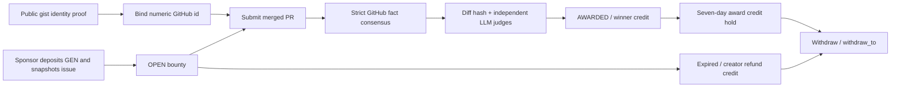

# IssueBountyEscrow

[GitHub Actions workflow](.github/workflows/ci.yml) · [Historical report](FINAL_REPORT.md)

GitHub issue bounties escrowed and judged by GenLayer intelligent-contract consensus. Sponsors define acceptance criteria; developers prove GitHub identity, submit merged PRs, and withdraw rewards after independent AI review.

**Deployment status:** The existing minified Bradbury contract is recorded at
[`0xAEDd265fCE73a9e50e8CcF6a72d78687fc4040DE`](https://explorer-bradbury.genlayer.com/address/0xAEDd265fCE73a9e50e8CcF6a72d78687fc4040DE),
with demo bounty #0 funded with 0.0001 test GEN. The readable redeploy candidate
has **not** been deployed. See [deployment record](deployments/bradbury.json)
and [progress](progress.md#readable-redeploy-candidate). Testnet only.

The [contract source](contracts/issue_bounty_escrow.py) uses descriptive names,
normal formatting and public method docstrings. A reproducible stored ZIP
packages its exact source as a zlib payload with a checksum-verified Python
loader. The readable source is **33,967 bytes**; the deployment package is
**9,784 bytes**, estimated at **8,627,504 gas** on Bradbury (target ≤15.5M).
Upload package bytes for redeployment; a raw Python upload still exceeds the cap.
The public ABI, errors, events, V2 prompt and security behavior are preserved.
See [packaging research and rationale](docs/CONTRACT_NOTES.md),
[package manifest](artifacts/issue_bounty_escrow.package.json), and
[estimate evidence](artifacts/readable-redeploy-gas.json).

Build and estimate without signing or sending a transaction:

```bash
.venv/bin/python scripts/build_contract_package.py
node scripts/estimate_deploy_gas.mjs
```

The estimator resolves the installed `genlayer-js`/`viem` packages from
`/home/box/genlayer-testnet` by default. Supply a different SDK installation
as its second argument after the package path. The loader/package also ran in
the actual pinned GenVM v0.2.12 executable locally; this is runtime evidence,
not a new Bradbury deployment or a portal submission.

## How it works



Each accepted claim must belong to the bound numeric GitHub id, be merged between bounty creation and its deadline into the default branch by another GitHub id, and have an affirmative closing line in its immutable merge commit message. Editing the PR title/body cannot establish eligibility. Failed business claims are recorded for audit; transient infrastructure errors leave state untouched. Zero-value reputation bounties are supported alongside funded bounties.

## Consensus

| Stage | Evidence | Equivalence |
| --- | --- | --- |
| ND-1a identity / ND-1b proof | GitHub user id, then exact contract/wallet/nonce gist marker and owner id | two canonical JSON strict_eq calls; storage nonce captured between calls |
| ND-2 bounty | Open issue metadata and bounded snapshot | processed canonical JSON, strict_eq |
| ND-3 claim facts | Merge metadata, independent merger, default branch, immutable commit reference, raw diff SHA-256 | processed canonical JSON, strict_eq |
| ND-4 assessment | Re-fetched hash-anchored diff, snapshot and criteria | independent LLM rerun; exact decision, score ±2, reject criterion Hamming distance ≤1 |

Validators read their own evidence and call their own LLM. The decision is ACCEPT only when every criterion is met and the score reaches the sponsor's minimum. Score tolerance never overrides a disagreement across that threshold. Summaries do not decide payment. A forged, well-formed ACCEPT is rejected when the validator independently judges REJECT.

`strict_eq` fits stable facts. Comparative LLM answer matching adds another subjective comparison; non-comparative validation does not independently answer the payment question. The custom validator compares explicit decision fields instead. See [consensus specification and measured results](docs/CONSENSUS.md).

## API

| Write method | Purpose |
| --- | --- |
| `bind_github(github_login)` | Verify the gist owner and exact description `genlayer-bounty-bind:<lowercase contract address>:<lowercase caller address>:<current nonce>`; advance the GitHub id's nonce on success |
| `create_bounty(repo, issue_number, criteria: list[str], deadline, min_score)` | Payable; snapshot open issue, 1–5 unique criteria, escrow `value` |
| `submit_claim(bounty_id, pr_number)` | Record a rejection or award escrow to claimant credit |
| `refund(bounty_id)` | Creator only, OPEN and strictly after deadline + grace |
| `withdraw()` | After the credit hold, clear caller's positive credit and request a transfer to the caller |
| `withdraw_to(recipient)` | Same credit/hold checks; caller chooses a receiving EOA; zero, malformed and escrow addresses are rejected |

Constructor: `(claim_grace_seconds=259200, max_claims_per_claimant=3)` must be supplied explicitly. Config bounds: grace 1 second–30 days, attempt limit 1–10. Deadlines: one hour–180 days from transaction time. Minimum score: 1–10. Criteria: nonempty, trimmed, unique, at most 200 characters each.

Views: `get_config`, `get_bounty` (includes `awarded_at`), `get_bounties(offset, limit≤50)`, `get_bounty_count`, `get_claim`, `get_claims_for_bounty`, `get_github_binding`, `get_wallet_for_github_id`, `get_credit`, `get_accounting`, `get_claim_count`, `get_claim_count_for_github_id`, `get_bind_nonce`, `get_credit_unlock_at`. Wallet claim counts resolve the currently bound GitHub id; use the numeric-id view after unbinding. See [ABI](artifacts/abi.json). Events: GithubBound, BountyCreated, ClaimEvaluated, BountyAwarded, BountyRefunded, Withdrawn.

Rejection reasons: PR_NOT_FOUND, WRONG_BASE_REPO, NOT_MERGED, AUTHOR_MISMATCH, NOT_DEFAULT_BRANCH, MERGER_NOT_VERIFIED, SELF_MERGED, MERGED_BEFORE_BOUNTY, MERGED_AFTER_DEADLINE, NO_ISSUE_REFERENCE, CRITERIA_NOT_MET, SCORE_BELOW_MIN. Repeated judged `(bounty, PR, raw diff hash)` reverts with ALREADY_JUDGED before another LLM call. Attempts are limited per bounty/GitHub id, across wallet migration. Reverts have fixed `[EXPECTED]`, `[EXTERNAL]`, `[TRANSIENT]` or `[LLM_ERROR]` messages. See [PRD security amendments](docs/PRD_DEVIATIONS.md).

## Reproduce tests

Python 3.12+:

```bash
python3.12 -m venv .venv
source .venv/bin/activate
pip install -r requirements.txt
export GENVM_VERSION=v0.2.12
python scripts/check.py check contracts/issue_bounty_escrow.py --json
python scripts/check.py typecheck contracts/issue_bounty_escrow.py
pytest tests/direct tests/experiments -v -W error::RuntimeWarning
```

The cache wrapper runs the official GenVM linter/semantic validator without suppressing rules. Caches live in a user-owned mode-0700 directory under `~/.cache/issue-bounty`, with a fresh private temporary directory if HOME is read-only. Ownership, permissions and symlinks are checked before loading code. A persistent private cache can be selected with `ISSUE_BOUNTY_CACHE_DIR`; this workspace uses `/home/box/.genlayer/issue-bounty-cache`. Set `GENVM_VERSION=v0.2.12` for lint/typecheck; direct tests pin that same release explicitly. Tests use the actual SDK, sanitized public fixtures, strict mocks, fixed transaction time and closure pickling checks. Current result: **149 passed** (all 147 existing tests plus two package integrity tests).
The complete suite also passes against the shipped loader with
`ISSUE_BOUNTY_TEST_PACKAGE=1`. SDK lint, semantic validation and typecheck pass;
the generated ABI matches [artifacts/abi.json](artifacts/abi.json) exactly.
The repository's GitHub Actions workflow was left unchanged; these results
are local checks.

gltest 0.29.2 has incomplete `spawn_sandbox` replay. T-N9–T-N12 and other replay cases use our test-only adapter, which executes the callback in the same process and converts exceptions to SDK result types. Its error conversion and isolation differ from real GenVM; these are weaker callback-level evidence, not multi-validator or protocol validation. The new negative VM-error test verifies callback rejection only. Studio I-4 includes committee disagreement over decisions and immutable references and must supplement these tests when Studio is available. Payout tests independently model native deposits/transfers and assert `contract_balance`; that model does not execute an actual child transfer. The mocked committee and real LLM suites were **11 skipped** due to absent Studio; OpenRouter is also unavailable. See [Studio/OpenRouter setup](docs/STUDIO.md).

## Bradbury deployment and small funded demo

Network: chain **4221**, [official RPC/network documentation](https://docs.genlayer.com/developers/networks), [official faucet](https://testnet-faucet.genlayer.foundation), [Bradbury explorer](https://explorer-bradbury.genlayer.com). No mainnet is supported by the scripts.

A fresh CLI-encrypted keystore is stored outside the repo at `/home/box/.genlayer/keystores/issue-bounty-deployer.json`; its strong password file `/home/box/.genlayer/deployer.pass` has mode 0600. Scripts decrypt in process memory. They do not inspect old wallet environment variables or export private keys.

```bash
python3.12 -m venv .network-venv
.network-venv/bin/pip install -r requirements-network.txt
bash scripts/deploy_bradbury.sh --preflight
# After faucet funding, compatible network tooling and measured fee estimates:
bash scripts/deploy_bradbury.sh --fees-file artifacts/fee-estimates.json
.network-venv/bin/python scripts/demo_flow.py --network testnet-bradbury \
  --fees-file artifacts/fee-estimates.json --reward-wei 100000000000000
```

The demo reward is **0.0001 test GEN**, capped at 0.001 test GEN. Fee JSON contains separate `deploy`, `bind_github`, `create_bounty`, `submit_claim`, `withdraw` entries with the SDK's measured distribution and feeValue; withdraw also requires measured external-message allocations. Fee profiles could not be generated without Studio. Stable CLI 0.39.2 has a missing estimate function; RC 0.40.0-rc.3 reaches FeeManager but `quoteGasPrice()` reverts. Resolve compatibility and quote fees before sending; do not assume the network is gasless from those errors. Python network SDK 0.19.0rc2 is isolated from the stable gltest dependency set.

After deployment, look up the account's numeric GitHub id and call `get_bind_nonce(id)` (initially 0). Publish a gist owned by that id with `genlayer-bounty-bind:<contract>:<wallet>:<nonce>` using lowercase hex addresses, then bind. Every successful bind advances the nonce; an old proof cannot reclaim a migrated identity or bind another deployment.

The historical PRs #2/#3 and old address-only gist in the [sandbox manifest](deployments/sandbox.json) are **obsolete demo evidence**. A valid demo must create its bounty first, then have another GitHub id merge fresh partial/complete PRs into the default branch before the deadline. Include a standalone `Fixes #1` line in each merge commit message. Update the manifest selectors and mark `claim_evidence_status` as `ready_after_creation` only after verification. The demo pauses after creation until those selectors are ready, and again until award credits mature. Each sent transaction hash is persisted before waiting. The bounty id comes from that creation transaction's execution receipt, so concurrent creation and resumption cannot change it. If the network omits execution bytes, the script stops and retains the hash instead of guessing an id. The explorer contract link will be `https://explorer-bradbury.genlayer.com/address/<verified contract address>` after deployment.

## Security and limitations

Identity uses numeric ids, nonce-bound owner-checked proofs and persistent attempt counts across wallet migration. All text is stripped of Unicode control/format characters, angle brackets are escaped, and prompt data is JSON encoded. Sponsor criteria are inspection targets in `<acceptance_criteria>`; the judge uses only diff implementation evidence and excludes editable PR title/body. All nondeterministic captures are plain memory values. See [architecture](docs/ARCHITECTURE.md), [threat model](docs/THREAT_MODEL.md) and [review fix/test mapping](progress.md#review-round-1).

GitHub edits/rate limits can halt consensus. Immutable closing evidence accepts only standalone affirmative `Fixes/Closes/Resolves #n` or `owner/repo#n` lines; bare links and other prose are insufficient. The default branch is read at claim time and can change. Independent GitHub ids do not prevent colluding accounts. The first 12,000 diff characters are judged; missing evidence is rejected. LLM judgments remain fallible.

Awards record transaction-time `awarded_at`; a positive award locks the wallet's aggregate credit until at least `awarded_at + FINALITY_DELAY` (seven days). Later awards extend the hold for all credits, including previously matured awards/refunds. Refund-only credit is immediately withdrawable. Both withdrawal methods enforce the same hold and clear credit before emitting a transfer. `withdraw_to` lets a contract-wallet caller choose an EOA; the contract cannot establish that an address is an EOA. Synchronous request-emission errors restore credit/accounting before propagating the error.

**Unverified protocol behavior:** seven days is a conservative local policy, not a verified Bradbury appeal/finality window. Whether an overturned award rolls back dependent withdrawals and when emitted messages become irreversible still requires live testing. `total_withdrawn` counts requested transfers. A later failed child transfer cannot be caught by this contract and has no automatic recovery; recipient selection helps avoid failure but cannot recover a transfer already emitted. Before any production funding, verify an appeal/reversal and a deliberately failing child transfer on Bradbury, including fees, receipt statuses and balances. Live fees, committee consensus and final EOA delivery remain unverified. No production or scoring claim is made.

This is a new independent repository, not a boilerplate fork. Future work includes production transfer recovery and broader live consensus measurement, followed by any separately approved frontend. MIT licensed. The owner submits builder evidence; this agent does not submit the portal form.
