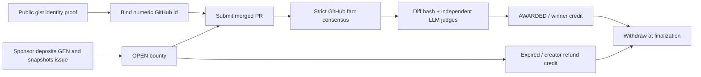

# IssueBountyEscrow

[Prepared GitHub Actions workflow](docs/ci.yml) · [Final report](FINAL_REPORT.md)

GitHub issue bounties escrowed and judged by GenLayer intelligent-contract consensus. Sponsors define acceptance criteria; developers prove GitHub identity, submit merged PRs, and withdraw rewards after independent AI review.

**Deployment status:** Bradbury deployment and the funded demo are blocked by faucet GitHub sign-in / Turnstile and an unverified live fee policy. No contract address or demo transaction exists yet. See [deployment record](deployments/bradbury.json), [progress](progress.md) and [final report](FINAL_REPORT.md). The new dedicated deployer address is `0x8f374a83965b2143bea962a48c8dacaf0db62d16` (public). Testnet only.

## How it works



Escrow removes the sponsor's ability to delay an accepted payout. Each accepted claim must refer to the correct issue, be merged before the deadline, and belong to the bound numeric GitHub id. Failed business claims are recorded for audit; transient infrastructure errors leave state untouched. Zero-value reputation bounties are supported alongside funded bounties.

## Consensus

| Stage | Evidence | Equivalence |
| --- | --- | --- |
| ND-1 identity | GitHub user id and exact public gist marker | processed canonical JSON, strict_eq |
| ND-2 bounty | Open issue metadata and bounded snapshot | processed canonical JSON, strict_eq |
| ND-3 claim facts | Merge metadata, author, base repo, issue reference, raw diff SHA-256 | processed canonical JSON, strict_eq |
| ND-4 assessment | Re-fetched hash-anchored diff, snapshot and criteria | independent LLM rerun; exact decision, score ±2, reject criterion Hamming distance ≤1 |

Validators read their own evidence and call their own LLM. The decision is ACCEPT only when every criterion is met and the score reaches the sponsor's minimum. Score tolerance never overrides a disagreement across that threshold. Summaries do not decide payment. A forged, well-formed ACCEPT is rejected when the validator independently judges REJECT.

`strict_eq` fits stable facts. Comparative LLM answer matching adds another subjective comparison; non-comparative validation does not independently answer the payment question. The custom validator compares explicit decision fields instead. See [consensus specification and measured results](docs/CONSENSUS.md).

## API

| Write method | Purpose |
| --- | --- |
| `bind_github(github_login)` | Verify a public gist description exactly equal to `genlayer-bounty-bind:<lowercase caller address>` |
| `create_bounty(repo, issue_number, criteria: list[str], deadline, min_score)` | Payable; snapshot open issue, 1–5 unique criteria, escrow `value` |
| `submit_claim(bounty_id, pr_number)` | Record a rejection or award escrow to claimant credit |
| `refund(bounty_id)` | Creator only, OPEN and strictly after deadline + grace |
| `withdraw()` | Clear caller's positive credit, emit EOA native transfer |

Constructor: `(claim_grace_seconds=259200, max_claims_per_claimant=3)` must be supplied explicitly. Config bounds: grace 1 second–30 days, attempt limit 1–10. Deadlines: one hour–180 days from transaction time. Minimum score: 1–10. Criteria: nonempty, trimmed, unique, at most 200 characters each.

Views: `get_config`, `get_bounty`, `get_bounties(offset, limit≤50)`, `get_bounty_count`, `get_claim`, `get_claims_for_bounty`, `get_github_binding`, `get_wallet_for_github_id`, `get_credit`, `get_accounting`, `get_claim_count`. See [ABI](artifacts/abi.json). Events: GithubBound, BountyCreated, ClaimEvaluated, BountyAwarded, BountyRefunded, Withdrawn.

Rejection reasons: PR_NOT_FOUND, WRONG_BASE_REPO, NOT_MERGED, AUTHOR_MISMATCH, MERGED_AFTER_DEADLINE, NO_ISSUE_REFERENCE, CRITERIA_NOT_MET, SCORE_BELOW_MIN. Reverts have fixed `[EXPECTED]`, `[EXTERNAL]`, `[TRANSIENT]` or `[LLM_ERROR]` messages. Full reasons/interfaces are specified in [approved PRD](docs-PRD.md).

## Reproduce tests

Python 3.12+:

```bash
python3.12 -m venv .venv
source .venv/bin/activate
pip install -r requirements.txt
python scripts/check.py check contracts/issue_bounty_escrow.py --json
pytest tests/direct tests/experiments -v -W error::RuntimeWarning
```

The cache wrapper runs the official GenVM linter/semantic validator under `/tmp`. It does not suppress rules. Tests use the pinned actual SDK, sanitized public fixtures, strict mocks, fixed transaction time and closure pickling checks. Current result: **94 passed** (93 direct/unit + 1 M0 SDK probe). The prepared GitHub Actions workflow runs these checks with Python 3.12 and needs no secrets. **CI publication is blocked:** the CLI token lacks `workflow` scope, and the connected app's write requires approval while this environment's approval policy is `never`. CI has not run.

On an owner-controlled machine, grant the CLI workflow permission (`gh auth refresh -h github.com -s workflow`), copy `docs/ci.yml` to `.github/workflows/ci.yml`, then commit/push and verify the run is green. The implementation workspace already contains the ready workflow file and retains a local `ci-ready` branch.

gltest 0.29.2 has incomplete Sandbox replay; a test-only adapter executes the original callback for strict_eq validation. It does not simulate VM isolation or committee finality. Direct tests observe external transfer requests; actual native balances require network verification. The mocked committee and real LLM suites were **10 skipped** due to absent Studio; OpenRouter is also unavailable. See [Studio/OpenRouter setup](docs/STUDIO.md) to run them.

## Bradbury deployment and small funded demo

Network: chain **4221**, [official RPC/network documentation](https://docs.genlayer.com/developers/networks), [official faucet](https://testnet-faucet.genlayer.foundation), [Bradbury explorer](https://explorer-bradbury.genlayer.com). No mainnet is supported by the scripts.

A fresh CLI-encrypted keystore is stored outside the repo at `/home/box/.genlayer/keystores/issue-bounty-deployer.json`; its strong password file `/home/box/.genlayer/deployer.pass` has mode 0600. Scripts decrypt in process memory. They do not inspect old wallet environment variables or export private keys.

```bash
python3.12 -m venv .network-venv
.network-venv/bin/pip install -r requirements-network.txt
bash scripts/deploy_bradbury.sh --preflight
# After faucet funding, compatible network tooling and measured fee estimates:
bash scripts/deploy_bradbury.sh --fees-file artifacts/fee-estimates.json
.network-venv/bin/python scripts/demo_flow.py --network testnet-bradbury \
  --fees-file artifacts/fee-estimates.json --reward-wei 100000000000000
```

The demo reward is **0.0001 test GEN**, capped at 0.001 test GEN. Fee JSON contains separate `deploy`, `bind_github`, `create_bounty`, `submit_claim`, `withdraw` entries with the SDK's measured distribution and feeValue; withdraw also requires measured external-message allocations. Fee profiles could not be generated without Studio. Stable CLI 0.39.2 has a missing estimate function; RC 0.40.0-rc.3 reaches FeeManager but `quoteGasPrice()` reverts. Resolve compatibility and quote fees before sending; do not assume the network is gasless from those errors. Python network SDK 0.19.0rc2 is isolated from the stable gltest dependency set.

Publish a public gist with the deployer marker before running `bind_github`. [Sandbox manifest](deployments/sandbox.json) holds an open issue and complete/partial merged PRs. Each sent transaction hash is persisted before waiting, allowing interrupted runs to resume. Successful execution is verified at finalization. The explorer contract link will be `https://explorer-bradbury.genlayer.com/address/<verified contract address>` after deployment.

## Security and limitations

Identity uses numeric ids, latest valid proof wins, and untrusted prompt tags are escaped. All nondeterministic captures are plain memory values. Accounting conserves deposits across escrow, credits and withdrawals. See [architecture](docs/ARCHITECTURE.md) and [threat model](docs/THREAT_MODEL.md).

GitHub edits/rate limits can halt consensus. The first 12,000 diff characters are judged; missing evidence is rejected. LLM judgments remain fallible. Attempt limits are per wallet and can be bypassed by identity migration. `total_withdrawn` means a transfer was requested; a failed downstream transfer is not automatically restored, and this version has no recovery method. Live fees, committee consensus and final EOA delivery remain unverified. No production or scoring claim is made.

This is a new independent repository, not a boilerplate fork. Future work includes production transfer recovery and broader live consensus measurement, followed by any separately approved frontend. MIT licensed. The owner submits builder evidence; this agent does not submit the portal form.
