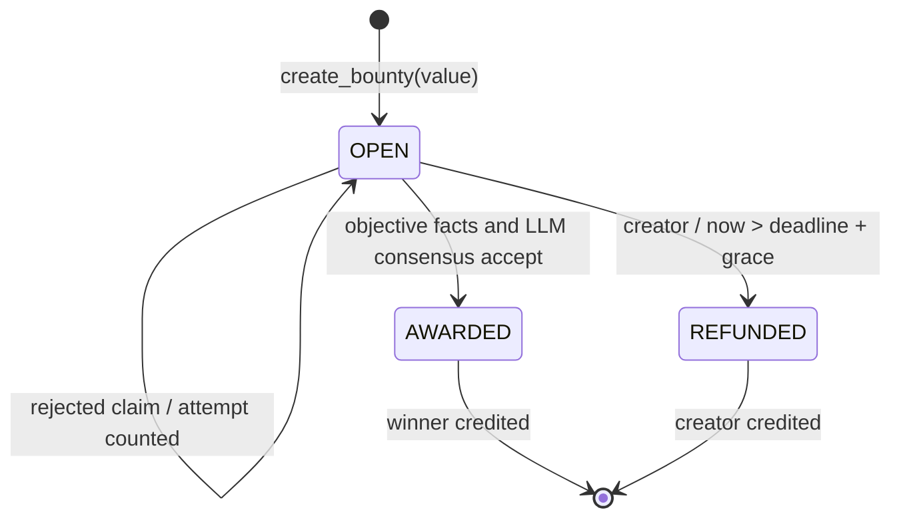

# Architecture

One independent intelligent contract owns bounties, claims, identity mappings and credits. No frontend or off-chain adjudication server is required. It reads public GitHub API data; there are no API keys in the contract.

1. A wallet proves control of a GitHub numeric id with an exact public gist description, `genlayer-bounty-bind:<lowercase-wallet-address>`. A newer valid proof transfers the id and removes stale mappings.
2. The sponsor escrows native GEN and snapshots an open issue plus 1–5 acceptance criteria. The deadline lies between one hour and 180 days after transaction time. Zero rewards are supported.
3. A bound claimant submits a PR number. Rejection gates run in order: missing PR, wrong base repo, unmerged PR, wrong author id, late merge, absent issue reference. Rejections record a claim and consume an attempt without an LLM call.
4. Qualified claims receive an independent LLM assessment anchored to the same raw diff bytes. Consensus compares decisions with bounded tolerances. Errors before settlement do not consume an attempt.
5. AWARDED/REFUNDED are terminal. Rewards move from escrow totals into per-wallet credits. Withdraw clears the credit and emits an EOA transfer request at finalization.

`Bounty` and `Claim` use storage-compatible dataclasses; collections are DynArray/TreeMap. Criteria and criterion booleans are canonical JSON strings in storage. The six events accompany persistent audit records. No nondeterministic callback reads contract storage: primitive values are captured before execution.

For all completed contract operations, `total_escrowed + total_credits + total_withdrawn == cumulative_bounty_deposits`. Withdrawn means transfer requested. It does not prove a downstream transfer was delivered. `contract_balance` reads the native SDK balance and can differ while transfers are pending or after failed external execution. See the threat model.

The default grace is 72 hours and per-wallet per-bounty attempt limit is 3. The binding address is transferable by GitHub proof; attempt limits are per wallet, not per GitHub id. That limits ordinary repeated attempts but does not prevent a GitHub owner cycling wallets. Claims themselves do not take a deposit.
