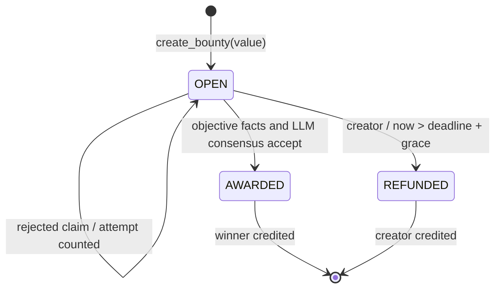

# Architecture

One independent intelligent contract owns bounties, claims, identity mappings and credits. No frontend or off-chain adjudication server is required. It reads public GitHub API data; there are no API keys in the contract.

1. Strict user consensus establishes the numeric GitHub id. A second strict callback checks `genlayer-bounty-bind:<lowercase-contract>:<lowercase-wallet>:<current-nonce>` and its gist owner id. Successful binding advances the nonce, invalidates old proofs and removes stale mappings.
2. The sponsor escrows native GEN and snapshots an open issue plus 1–5 acceptance criteria. The deadline lies between one hour and 180 days after transaction time. Zero rewards are supported.
3. A bound claimant submits a PR number. Gates run in order: missing PR, wrong base repo, unmerged PR, wrong author, non-default branch, unverified merger, self-merge, untrusted merger when an allowlist is set, merge before bounty creation, late merge, absent immutable commit reference. Commit SHA must match. Affirmative closing lines accept bullet prefixes, CRLF and comma lists; a paginated issue closed event with the exact merge SHA is an alternate association. Rejections consume an attempt without LLM use.
4. Qualified, unjudged diffs receive an independent hash-anchored LLM assessment without PR title/body. JSON encoded, escaped text remains evidence and sponsor criteria remain inspection targets. Infrastructure/schema errors do not consume an attempt or mark the diff judged.
5. AWARDED/REFUNDED are terminal. Rewards move into credits. Positive awards record `awarded_at` and extend aggregate wallet credit hold by seven days. Both withdrawals clear credit before requesting a transfer; `withdraw_to` supports a caller-selected EOA. Synchronous emission errors propagate for host transaction rollback; deferred failures cannot be caught. Only the constructor-fixed treasury can sweep positive native balance above escrow plus credits, without recreating cleared claimant credit. Confirm failed child delivery before reconciliation or retrying a sweep.

`Bounty` and `Claim` use storage-compatible dataclasses; collections are DynArray/TreeMap. Criteria and criterion booleans are canonical JSON strings in storage. The six events accompany persistent audit records. No nondeterministic callback reads contract storage: primitive values are captured before execution.

For all completed contract operations, `total_escrowed + total_credits + total_withdrawn == cumulative_bounty_deposits`. Withdrawn means transfer requested. It does not prove a downstream transfer was delivered. `contract_balance` reads the native SDK balance and can differ while transfers are pending or after failed external execution. See the threat model.

The default grace is 72 hours and the per-GitHub-id per-bounty attempt limit is 3, preserved across wallet migration. Completed judgments persist `(bounty, PR, raw diff hash)`; identical rejected diffs cannot be resampled. Separate ids/colluding accounts remain possible. Claims take no deposit. Later positive awards extend the hold for all credit, including refunds/mature awards; refund-only credit is immediately available. Seven days is local policy, not a verified protocol guarantee. See [PRD amendments](PRD_DEVIATIONS.md).

Payout tests model native balances independently from deposit inputs and emitted request amounts, asserting `contract_balance == total_escrowed + total_credits` after modeled delivery. A simulated stranded transfer fails this check. This does not execute a real network child transfer.
